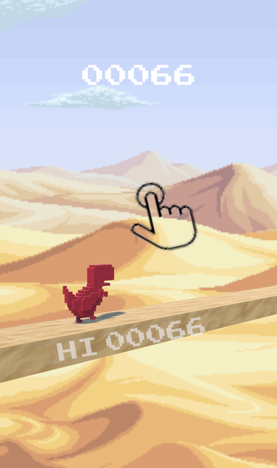
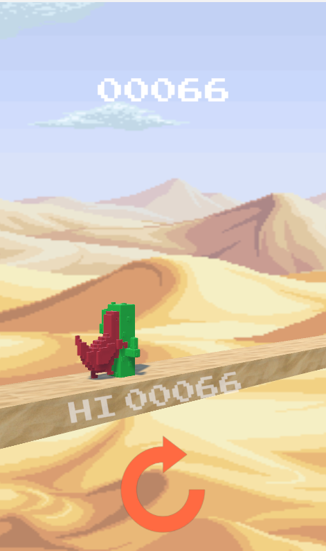

# DinoRun 3D

DinoRun 3D is a simple endless runner game inspired by the classic Chrome Dino game. This project was created as a learning exercise in Unity and 3D game development.

It was developed by me back in highschool with no prior coding background

## Screenshots

  
  

## Features

- Fast-paced endless running gameplay  
- Randomly spawned obstacles with increasing difficulty  
- Score tracking with high score persistence  
- Basic ground detection to prevent mid-air jumps  
- Automatic cleanup of off-screen obstacles for performance  
- Simple controls: jump with **Spacebar** or **Left Mouse Button**

## How to Run

### Option 1: Play the Standalone Build
1. Download the **Game** folder from the repository  
2. Run the executable (`.exe`) file inside the folder  

### Option 2: Open in Unity
1. Clone or download the entire repository  
2. Import the **Game Files** folder into a new Unity project  
3. Open the main scene and press **Play** in the Unity Editor  

## Controls

- **Jump:** Spacebar or Left Mouse Button  
- **Start / Restart:** Click the screen or press Spacebar  

## Notes

This project is shared as-is and was developed some time ago as a practice project. It may not follow current Unity best practices or be compatible with the latest versions without adjustments, but it remains a functional example of a basic 3D endless runner.

## License

This project is open-source. Feel free to use, modify, and share it.
